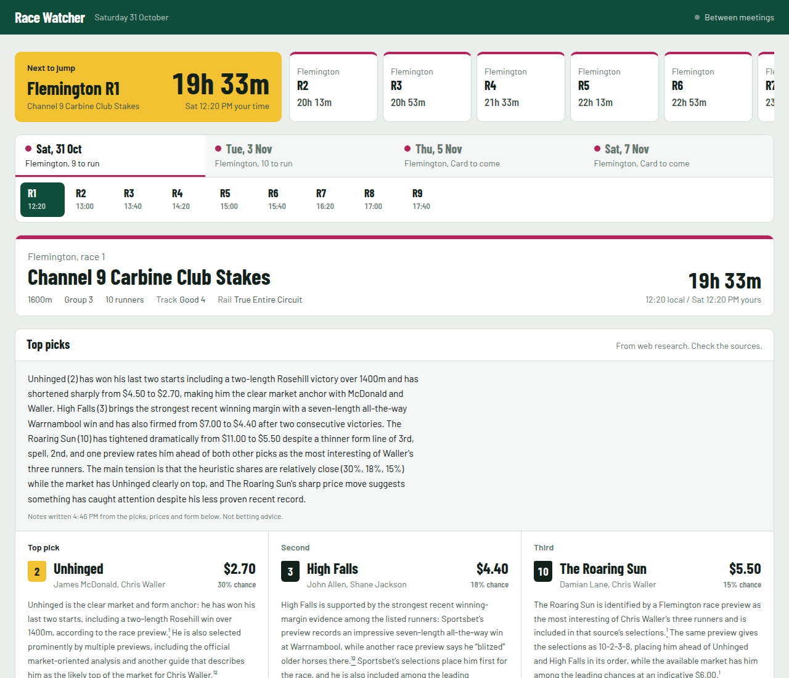
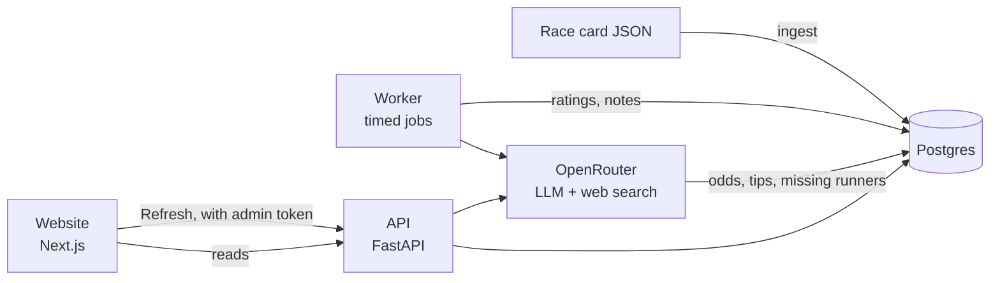

# Race Watcher

A race-day dashboard for Australian thoroughbred racing. For every race it shows the field, live
odds and how they're moving, a rating for each runner, the top three picks with sourced
reasoning, and a short plain-English note on why those runners are the picks.

It's built to follow the races you care about for a day or a few days, not to run all year.
Pick a meeting, a carnival or a handful of races, load their cards, and watch them come
together: prices firming and drifting, picks settling, notes updating. When the last race has
run, the worker goes quiet and costs nothing until you point it at the next set of races.

It's currently set up for the 2026 Flemington Spring Carnival: Derby Day, Melbourne Cup Day,
Oaks Day and Stakes Day.



> **Not betting advice.** Ratings come from a simple, explainable heuristic, not a trained model,
> and the odds and tips are gathered by an LLM doing web searches, which can be wrong or stale.
> If gambling is causing you harm, call Gambling Help on 1800 858 858.

## What it does

- **Race days and races.** One tab per race day (or per track, when several tracks race on the
  same day), and every race on the card, run or not.
- **Next to jump.** A live countdown to the next race, in Melbourne time and in yours.
- **Odds.** Fixed-odds win prices for every runner from one bookmaker (TAB, else Sportsbet, else
  Ladbrokes), checked every 15 minutes in the 2 hours before each race and kept as a history so
  you can see who's firming and who's drifting.
- **Market moves.** Any price move of 10% or more, for the race on screen or across all races.
  Moves only compare a bookmaker's price with its own earlier prices.
- **Ratings.** A win chance and rating for each runner, recomputed as prices change.
- **Top picks.** Three picks per race from web research, with numbered links to the sources.
- **Race notes.** A short summary of why the picks are the picks, written from the prices, form
  and ratings in the database and nothing else.
- **Refresh (admin only).** One button per day that runs the whole pipeline on demand: odds,
  tips, ratings, missing runners, then notes. Viewers get a read-only page; the button only
  appears in a browser that has the admin token. To enter it, open the site with `?admin` on the
  end of the address (e.g. `https://your-site/?admin`).

## How it works



There are three services and a database:

- **API** (`backend/`, FastAPI). Serves the race days, races, runners, prices, picks and notes.
  Also has `/admin` endpoints that do the expensive work (calling an LLM); those need an admin
  token.
- **Worker** (`backend/src/race_watcher/worker/main.py`). A small always-on process with two timed
  jobs:
  - **Odds, every 15 minutes.** Picks out the watched races jumping in the next 2 hours and sends
    one web-search request per race (a whole day in one request came back with only the first
    race or two priced). Each price is stored as a new snapshot, never overwriting the old ones,
    and a move of 10% or more against the same bookmaker's earlier price is recorded as an alert.
    With no race in its build-up, it does nothing and costs nothing.
  - **Morning check, 9:15am Melbourne time on race days** (`ODDS_CHECK_TIMES`). Prices every
    race on the day's card, whatever its start time, so the board reflects the market after the
    big early-morning money. These become the day's opening prices that later moves are
    measured against.
  - **Ratings and notes, every 10 minutes.** Re-rates the runners using the latest prices, then
    rewrites the note for any race whose prices, picks or field have changed. Races that haven't
    changed are skipped, so this costs nothing when the market is quiet.

  Outside racing hours, and once every race has run, the worker sits idle.
- **Website** (`frontend/`, Next.js). Reads from the API and refreshes as new data lands.
- **Postgres** holds everything.

### Where the data comes from

| Data | Source |
|---|---|
| Race card: races, fields, barriers, weights, jockeys, trainers, form figures | A JSON file in `backend/seed/`, put together from published final fields before each race day |
| Live odds | Fixed-odds win prices from one bookmaker per race (TAB, else Sportsbet, else Ladbrokes), found by an LLM with web search via [OpenRouter](https://openrouter.ai) (default `anthropic/claude-sonnet-4.5` with `:online`) |
| Top picks and their sources | [Perplexity Sonar](https://openrouter.ai/perplexity/sonar-pro) via OpenRouter |
| Runners missing from the card | Perplexity Sonar; these are marked "unverified" on the site |
| Race notes | The same LLM without web search, given only facts from the database |

There's no clean, free, official feed for Australian race fields and odds, which is why the card
comes from a JSON file and the odds come from LLM web search. The code is written so these can be
swapped: a Betfair Exchange adapter is included as a more reliable odds source if you have an
account.

### How runners are rated

`backend/src/race_watcher/adapters/heuristic.py` scores each runner from:

1. **The market.** The price turned into an implied chance (a $4.00 runner is about 25%). Live
   prices are used once there are any, otherwise the preview price from the card.
2. **Tipster consensus,** if the card has one for that runner.
3. **A small wet-track bump** for runners whose form notes mention a wet track.

The scores are then scaled so a race's chances add up to 100%. Because the market dominates, the
ratings mostly reflect what the prices say; they're there to make the numbers comparable at a
glance, not to beat the market.

### Design choices worth knowing

- **Ports and adapters.** The core code talks to three interfaces (`RaceCardSource`,
  `OddsSource`, `PredictionEngine` in `domain/ports.py`), and each source is an adapter behind one
  of them. Swapping where odds come from is a config change, not a rewrite.
- **The API is the contract.** The frontend's TypeScript client is generated from the API's
  OpenAPI schema, so a backend change that breaks the frontend fails the type check.
- **Prices are append-only.** Every price fetched is a new row, so price history, sparklines and
  movement alerts all come from the same data.
- **Notes can't make things up (as far as possible).** The note writer gets a fixed list of facts
  (picks, prices, form spelled out most-recent-first, ratings) and is told to use nothing else, to
  never infer class or distance from form figures, and to say so when the facts are thin.

## Running it locally

You'll need Python 3.12+, [uv](https://docs.astral.sh/uv/), Node 20+, and Postgres (or Docker
for it).

```bash
# 1. Database
docker run -d --name race-pg -e POSTGRES_USER=race -e POSTGRES_PASSWORD=race \
  -e POSTGRES_DB=race_watcher -p 5432:5432 postgres:16

# 2. Settings
cp .env.example .env          # then add your OPENROUTER_API_KEY
cp .env backend/.env

# 3. API (terminal 1)
cd backend
uv sync
uv run alembic upgrade head
uv run uvicorn race_watcher.api.app:app --reload          # http://localhost:8000/docs

# 4. Worker (terminal 2): loads the race card on first start
cd backend
uv run python -m race_watcher.worker.main

# 5. Website (terminal 3)
cd frontend
npm install
npm run dev                                               # http://localhost:3000
```

Locally, with `ADMIN_TOKEN` unset, the admin endpoints are open. Open
http://localhost:3000/?admin and type anything as the token to get the Refresh button.

Without an OpenRouter key the site still works from the race card alone: you'll see fields, form
and preview prices, but no live odds, picks or notes.

### Tests and checks

```bash
cd backend && uv run pytest              # backend tests (SQLite in memory, no network)
cd frontend && npx tsc --noEmit          # frontend type check
```

If you change an API response, regenerate the frontend client:

```bash
cd backend && uv run python -c "import json; from race_watcher.api.app import app; \
  open('openapi.json','w').write(json.dumps(app.openapi(), indent=2)+'\n')"
cd ../frontend && npm run gen:api:local
```

## Choosing what to watch

`backend/watch.json` says which races the app follows and where their card is:

```json
{
  "card": "seed/flemington-carnival-2026.json",
  "watch": [
    { "track": "Flemington", "date": "2026-11-03" },
    { "track": "Flemington", "date": "2026-11-07", "races": [7, 8, 9] },
    { "track": "Randwick",   "date": "2026-11-07", "races": [9] }
  ]
}
```

- Each line under `watch` is a meeting: a track on a date. Leave out `races` to watch the whole
  card, or list race numbers to watch just those.
- Only watched races appear on the site, get odds fetched, get rated, picked and written up.
  Watching one race costs a fraction of watching a whole carnival.
- The site shows the days from the first date listed to the last. Once every watched race has
  run, the worker goes idle.
- `card` is the race card file, relative to `watch.json`.

To watch something new:

1. Write its card as JSON in `backend/seed/` (see `flemington-carnival-2026.json` for the
   format). One entry per meeting. Races without a final field yet can have `"runners": []`,
   and a day with no card yet can have `"races": []`. The card can include more than you watch.
2. Update `watch.json`.
3. Deploy, then load the card with `POST /api/v1/admin/ingest` (with your admin token). Loading
   again is safe: it updates races and runners in place.

Without a `watch.json`, the app falls back to watching every race from `RACE_DATE` to
`RACE_DATE_END`, from the card at `SEED_FILE_PATH`.

## Configuration

All settings are environment variables; `.env.example` lists them with comments. The main ones:

| Variable | What it does |
|---|---|
| `DATABASE_URL` | Postgres connection |
| `WATCH_FILE_PATH` | The watchlist (default `watch.json` in `backend/`) |
| `RACE_DATE`, `RACE_DATE_END`, `SEED_FILE_PATH` | Fallbacks used only when there's no watchlist |
| `OPENROUTER_API_KEY` | Needed for odds, picks and notes |
| `OPENROUTER_MODEL` | Model for odds and notes |
| `OPENROUTER_RESEARCH_MODEL` | Model for picks and missing runners |
| `ADMIN_TOKEN` | Secret for the `/admin` endpoints and the Refresh button. **Set this in production** |
| `POLL_INTERVAL_SECONDS` | How often the worker fetches odds during a race day (default 900, 15 minutes) |
| `ODDS_CHECK_TIMES` | Fixed times each race day to price the whole card (default `09:15`, Melbourne time) |
| `MOVEMENT_THRESHOLD_PCT` | Price move that counts as an alert (default 10) |
| `NEXT_PUBLIC_API_BASE_URL` | The API's address, for the website (baked in at build time) |

### What it costs

Odds fetching is one web-search LLM call per race every 15 minutes during its 2-hour build-up,
so about 8 calls per race, plus one per race for the 9:15 morning check: around 80 for a 9-race
day. Notes only call the LLM when a race's
facts change. A full Refresh makes one odds call per race still to run, plus one research call
per race for picks and another for missing runners.
Check your usage on OpenRouter; raising `POLL_INTERVAL_SECONDS` is the main way to spend less.

## Deploying

It runs on [Railway](https://railway.app) as three services (api, worker, web) plus Postgres.
See [DEPLOY.md](DEPLOY.md).

## Project layout

```
backend/
  src/race_watcher/
    api/            FastAPI app, routers and response schemas
    adapters/       seed file, OpenRouter, heuristic, Betfair, mock odds
    domain/         ports (interfaces) and plain domain models
    services/       ingest, odds polling, ratings, picks, field expansion, race notes
    repositories/   database queries
    db/             SQLAlchemy models
    worker/         the timed jobs
  alembic/          database migrations
  seed/             race cards
  tests/
frontend/
  src/
    app/            the page
    components/     race nav, next to jump, picks, field, movement feed, refresh bar
    lib/            API client (generated), time and track helpers
```

## Licence

MIT. See [LICENSE](LICENSE).
